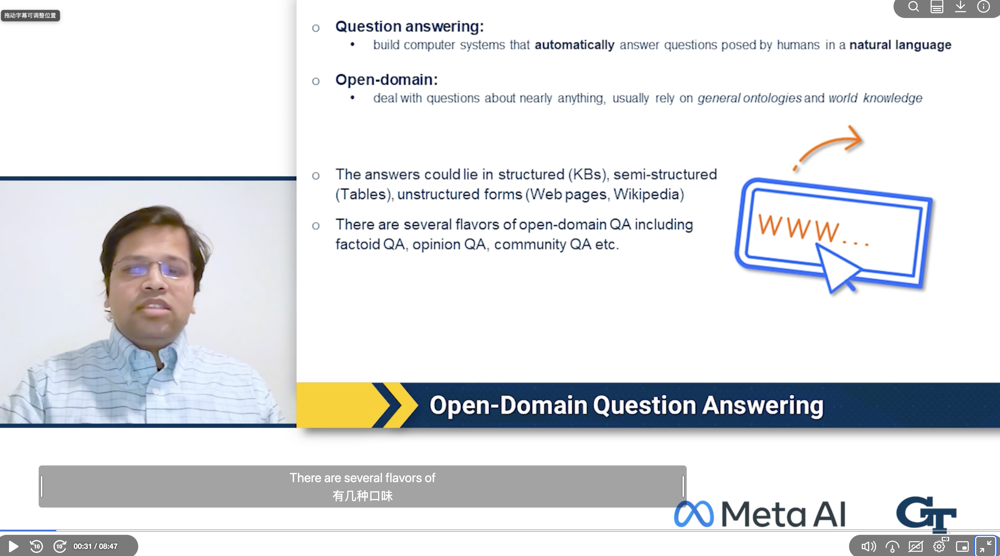

# Canvas / Kaltura Bilingual Subtitles

**English** | [简体中文](README.zh-CN.md)

Watch Canvas / Kaltura videos with synchronized bilingual subtitles. Import English captions, translate them using your own API key, and display both languages inside the player.

**[Install latest version](https://github.com/YujunGit/canvas-bilingual-subtitles/releases/latest/download/canvas-bilingual.user.js)** · [Installation](#installation) · [Demo](#demo) · [Troubleshooting](#troubleshooting)

You need **Tampermonkey + a Google or Azure translation API key**. No repository download or terminal commands required. Translation may incur provider charges; automatic translation is off by default.

## Features

- **Automatic subtitle import:** Find the single English SRT entry in the downloads panel and import it directly, without selecting a file from your Downloads folder.
- **Optional automatic translation:** Retrieve, translate, and display captions after a video loads, or run the workflow manually.
- **Two translation providers:** Google Cloud Translation Basic v2 and Azure AI Translator, with an extensible Provider Adapter interface.
- **Synchronized display:** Bilingual, original-only, and translation-only modes, plus a timing offset. Follows pauses, seeking, and playback speed changes.
- **Batching and caching:** Deduplicate text, batch requests, reuse completed batches after failures, cancel translation, and clear the cache.
- **Subtitle appearance:** Customize text and background colors and background transparency. Drag subtitles, remember their position, or restore the default position.
- **Compact settings panel:** A draggable button with a saved position and diagnostics collapsed by default.

## Roadmap

<details>
<summary>Explore plans: more APIs, more languages, macOS translation</summary>

These items are planned and **not yet implemented**. Providers, compatibility, and release order will depend on feasibility testing and user feedback.

### More translation APIs

- [ ] Extend Provider Adapters and evaluate services such as DeepL, Baidu Translate, and Tencent Cloud Machine Translation.
- [ ] Explore APIs for translation with large language models, including configurable OpenAI-compatible endpoints.
- [ ] Add provider-specific credentials, language mappings, batch limits, and error messages while keeping translation caches isolated by provider.
- [ ] Add setup documentation and tests for subtitle order, response formats, cancellation, and failure recovery.

### More languages

- [ ] Expand source and target language selection to support subtitle input beyond English and more translation language pairs.
- [ ] Offer language options based on the selected provider's capabilities and explain unsupported combinations.
- [ ] Improve subtitle layout for different writing systems, including right-to-left languages, and verify parsing, line wrapping, and synchronization.

### macOS system translation

- [ ] Explore integration with Apple's Translation framework through a local Provider using macOS translation capabilities.
- [ ] Validate a local macOS companion app that calls the framework and communicates with the userscript, without assuming Tampermonkey can call native frameworks directly.
- [ ] Verify system requirements, supported languages, language resource downloads, and offline conditions, and design the initial authorization and preparation flow.
- [ ] Validate access controls for local communication, batch translation, cancellation, and error recovery. Prompt users to choose an existing online Provider when the local service is unavailable.

This integration is exploratory. The current version does not support Apple Translation, and support for every language or macOS version is not promised.

</details>

## Installation

1. **Install the extension:** Get [Tampermonkey](https://www.tampermonkey.net/) and follow its prompts to enable userscripts and site access.
2. **Install the script:** Open [Install latest version](https://github.com/YujunGit/canvas-bilingual-subtitles/releases/latest/download/canvas-bilingual.user.js) and click **Install** in Tampermonkey, or **Update** if already installed.
3. **Open a video:** Refresh your Canvas course page and load a Kaltura video. The **双语字幕** (Bilingual Subtitles) button inside the player indicates that the script is running.

<details>
<summary>The link downloads a file or displays code instead of opening Tampermonkey?</summary>

Open the downloaded `canvas-bilingual.user.js` in a text editor (or copy all the code shown in the browser). Create a script in the Tampermonkey dashboard, **replace the entire default template**, and save. For an existing installation, replace its contents instead of appending code or creating a duplicate.

Install only the `.user.js` file, not `.meta.js` or the Source code archive.

</details>

## First use

The settings UI currently uses Chinese labels; the labels below match the controls you will see.

1. Open **双语字幕** (Bilingual Subtitles) **inside the player**. Select a provider, enter your API key and target language, then click **保存设置** (Save settings).
2. Wait for English captions to import automatically. The panel will show the filename and cue count when ready.
3. Click **批量翻译** (Batch translate). Alternatively, click **自动获取并翻译** (Retrieve and translate) to perform both steps.
4. Play the video to see the original and translated captions. Enable **获取后自动翻译** (Translate automatically after retrieval) if you want subsequent videos translated automatically.

| Provider | Settings required |
| --- | --- |
| Google Cloud Translation Basic v2 | A project API key with the API enabled, and target language |
| Azure AI Translator | API key, target language, and the region required by your resource (applicable global single-service resources may leave it blank) |

Currently supports **English → Simplified Chinese, Traditional Chinese, Japanese, or Korean**. Google and Azure keys are saved separately.

**Automatic import failed?** Download the English SRT from the player's downloads panel, select **手动导入英文 SRT** (Manually import English SRT), then click Batch translate. Automatic retrieval requires a single English SRT entry and may not work with every institution's player setup.

## Demo

### Screenshot

<!-- DEMO_SCREENSHOT_START: replace the placeholder below with the image Markdown from docs/media/README.md. -->



<!-- DEMO_SCREENSHOT_END -->

### Video

<!-- DEMO_VIDEO_START: replace the placeholder below with the uploaded GitHub video attachment URL on its own line. -->

https://github.com/user-attachments/assets/77f852fa-c377-4738-bd02-1f282a2d891d

<!-- DEMO_VIDEO_END -->

<!-- Maintainer: see docs/media/README.md for upload instructions. Do not use school course material without permission. -->

## Customize subtitles

| Goal | Control |
| --- | --- |
| Move captions | Drag the middle of the subtitle box; release to save |
| Resize the box | Hover over it and drag either side handle; the opposite edge stays fixed |
| Change colors | Use 字幕文字颜色 (Text color) or 字幕背景颜色 (Background color) |
| Change transparency | Adjust the slider: 0% is opaque, 100% is transparent; text stays opaque |
| Show only one language | Change 显示模式 (Display mode); the choice is remembered, with bilingual as the initial default |
| Correct timing | Adjust subtitle delay; positive values show captions later |
| Reset layout | Use the restore-default position or width buttons |

Defaults: white text, black background, 22% background transparency, and 88% video width. Width ranges from 20–100%, with automatic text wrapping. Position and width are relative to the video; appearance is saved separately by site and page/player-frame context. Disable the player's own captions if they overlap.

## Updating

Enable update checks in Tampermonkey to periodically retrieve new GitHub Releases. Refresh the course page after updating; do not uninstall first.

To update manually, open the [latest complete userscript](https://github.com/YujunGit/canvas-bilingual-subtitles/releases/latest/download/canvas-bilingual.user.js) again and update the existing installation.

<details>
<summary>Migrating an older version or a manually overridden update URL?</summary>

Install the complete script from the link above over your existing installation. If you manually set Update URL in Settings, replace it with this address and save:

```text
https://github.com/YujunGit/canvas-bilingual-subtitles/releases/latest/download/canvas-bilingual.user.js
```

Both `@updateURL` and `@downloadURL` use this complete script address. Do not install the `.meta.js` file.

</details>

## Compatibility and limitations

- The script runs independently in matching pages and iframes. A button may also appear on the outer Canvas page; use the panel inside the actual player.
- Default matches are `*.instructure.com`, `cdnapisec.kaltura.com`, and `*.mediaspace.kaltura.com`. Custom institutional domains require an appropriate `@match` entry.
- Only a single unambiguous loaded video is selected automatically. Multiple valid videos require manual selection.
- Automatic retrieval requires exactly one English SRT entry in the downloads panel. Ambiguous candidates, permission restrictions, or player changes may require manual import.
- SRT supports UTF-8, BOM, CRLF, and multiline text, with a 5 MB file limit.
- Subtitle overlays work on normal pages. Container fullscreen behavior depends on the player layout. Native video fullscreen and picture-in-picture do not display the DOM subtitle overlay.
- Replacing the video element or changing its source clears the current captions to prevent displaying captions from another video. Some quality changes may also trigger retrieval again.

## Storage and costs

API keys and settings are stored in Tampermonkey's script storage, not the webpage's localStorage or project files. This storage is not an encrypted keychain; extension backup and synchronization settings may affect where data goes.

Translation sends subtitle text to the selected Google or Azure service. Google v2 places the key in a request URL parameter; Azure places it in a request header. Redact credentials before sharing network logs.

Cache entries are separated by provider, version, source language, target language, and original text. They expire after 30 days and are trimmed to at most 5,000 entries at startup and after translation. Retrieving identical captions can reuse valid cached translations. Source subtitle files remain only in the current page's memory.

Each batch contains at most 50 texts and 4,500 UTF-16 characters. HTTP 429 responses are retried up to twice; other request failures require a manual retry. Cancellation cannot undo requests already sent or their charges. Multiple tabs translating the same captions may still send duplicate requests.

## Troubleshooting

**Translation finished, but no subtitles appear?**

Click **检测播放器** (Inspect player). Check that the selected course video has a real duration rather than a standby element showing “? 秒”. Also check the display mode and **显示字幕** (Show subtitles) toggle.

**The button does nothing, or a large block of code appears?**

Check for mixed versions or duplicate installations. Replace the entire userscript with the updated file and refresh the course page.

**Automatic retrieval does not work?**

Load the video, then click **自动获取并翻译**. Confirm that the downloads panel offers English SRT captions. If it still fails, import manually and expand **高级诊断** (Advanced diagnostics) to inspect the player state.

**Source edits do not appear in the browser?**

The browser runs the installed build. Rebuild and update the userscript after changing the source, then refresh the course page.

## Development and extension

The project uses JavaScript ES Modules with no third-party npm dependencies for building or testing. Use Node.js with its built-in test runner; the project has been run on Node.js 24.

```sh
npm run build
npm test
```

| File | Responsibility |
| --- | --- |
| `src/main.js` | Settings UI, storage, and workflow orchestration |
| `src/auto-subtitles.js` | English SRT discovery, download capture, and automatic import |
| `src/subtitles.js` | SRT parsing, active cue selection, and batching |
| `src/providers.js` | Translation adapters and network transport |
| `src/translation.js` | Deduplication, caching, retries, and cancellation |
| `src/player.js` | Video discovery, binding, and subtitle rendering |
| `src/floating-ui.js` | Draggable button and panel positioning |
| `build.mjs` | Standalone userscript generation |
| `test/` | Parsing, adapter, cache, and automatic import tests |

To add a service, implement this interface in the Provider registry, then add credential controls and precise `@connect` domains:

```js
{
  id,
  version,
  name,
  language(target),
  async translate(texts, config, post) { /* Return string[] */ }
}
```

Results must match the input length and order. Update the cache version or cache key when changing the translation model or settings that affect the output.

### Validation coverage

- Automatic English SRT import and Google translation have been validated with Edge, Tampermonkey, and one Canvas / Kaltura PlayKit course environment.
- Azure request formats have mock test coverage; end-to-end testing with a real key has not been completed.
- Automated tests cover SRT formats, timing boundaries, video selection, request formats, cache isolation, cancellation, failure recovery, and download capture.
- Tests use `test/fixtures/synthetic.srt`, an original synthetic fixture distributed under the project's MIT License. No course subtitles are required. SRT files are ignored by default; only this synthetic fixture is explicitly allowed.
- Compatibility with every institutional setup, browser, fullscreen mode, or future player version is not guaranteed.

## Changelog

Versions are listed newest first. Dates indicate implementation dates, not published GitHub Releases.

### v0.3.4 · 2026-11-12

- Move public update and download URLs to the latest GitHub Release’s complete `.user.js` asset.
- Document migration from previous update URLs and link installation to the latest release.
- Keep local builds available, using the complete script for both update checks and downloads.

<details>
<summary>Previous versions (v0.3.3 and earlier)</summary>

### v0.3.3 · 2026-11-12

- Resize the subtitle box by dragging its left or right edge, with automatic width saving and a reset control.
- Preserve dragging from the middle to reposition subtitles; keep resizing within video bounds.
- Save width relative to the video (20–100%, default 88%) and wrap text to fit.
- Add resize boundary tests; all 21 automated tests and build checks pass. Browser interaction has not been verified for this version.

### v0.3.2 · 2026-11-11

- Add subtitle text and background color settings with live preview and automatic saving.
- Combine background color with the existing transparency setting; retain white-on-black defaults.

### v0.3.1 · 2026-11-11

- Default the initial display mode to bilingual; automatically save changes and restore them after refresh.
- Store display mode separately so configuration saves from other pages or player frames do not overwrite the choice.

### v0.3.0 · 2026-11-11

- Add a background transparency slider with live preview and automatic saving while keeping text opaque.
- Support dragging subtitles, saving relative positions, constraining the box to the video, and restoring its default position.
- Keep the current caption visible during a drag to prevent cue changes from interrupting it.
- Complete automated tests and build checks; browser interaction validation for this version is left to the user.

### v0.2.1 · 2026-11-08

- Fix matching of the downloads panel close control, including non-button elements with `aria-label`.
- Ignore hidden download entries during subtitle discovery.

### v0.2.0 · 2026-11-08

- Add automatic English SRT retrieval and import using the Kaltura downloads panel's existing workflow.
- Add a retrieve-and-translate button and independent automatic retrieval and translation toggles.
- Display the imported filename and cue count; reuse the cache or call the translation service after import.
- Check for ambiguous candidates, timeouts, cancellation, file size, and video changes; retain manual import on failure.
- Validate automatic import of 161 English cues and Google translation on a real course page.

### v0.1.4 · 2026-11-08

- Remove empty subtitle rows while preserving meaningful line breaks, fixing extra gaps between translated Chinese lines.
- Apply display cleanup to cached translations without requiring translation again.

### v0.1.3 · 2026-11-08

- Add update metadata generation and version-check support.
- Read the installation version consistently from `package.json` during builds.

### v0.1.2 · 2026-11-08

- Move the subtitle button's default position to the left, away from the player's upper-right toolbar.
- Support dragging the button, remembering its position, and adapting panel placement to window size.
- Move raw player diagnostics into a collapsed Advanced diagnostics section.

### v0.1.1 · 2026-11-08

- Fix binding to Kaltura's empty standby video, which prevented translated subtitles from appearing.
- Automatically select the single loaded video and detect delayed loading; retain manual selection for multiple valid videos.

### v0.1.0 · 2026-11-08

- Introduce a modular Tampermonkey script supporting Google Cloud Translation Basic v2 and Azure AI Translator.
- Add manual English SRT import, a settings panel, key storage, batch translation, deduplication, caching, and cancellation.
- Implement bilingual, original-only, and translation-only display with synchronization and timing offsets.
- Add player diagnostics, iframe compatibility notes, and an extensible Provider Adapter interface.

</details>

## References

- [Tampermonkey documentation](https://www.tampermonkey.net/documentation.php)
- [Google Cloud Translation v2](https://cloud.google.com/translate/docs/reference/rest/v2/translate)
- [Azure Translator v3](https://learn.microsoft.com/en-us/azure/ai-services/translator/text-translation/reference/v3/translate)
- [Kaltura downloads plugin](https://github.com/kaltura/playkit-js-downloads)

## License

This project uses the [MIT License](LICENSE). Retain the copyright notice and license text when using, modifying, or distributing it.
