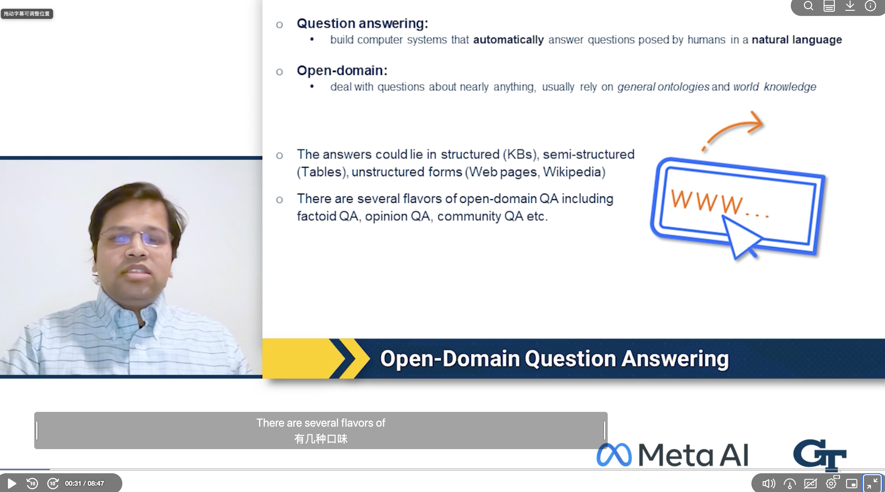

# Canvas / Kaltura 双语字幕

[English](README.md) | **简体中文**

为 Canvas 中的 Kaltura 视频添加同步双语字幕：获取英文字幕，使用你自己的翻译 API 翻译，并在播放器中显示。

**[安装最新版本](https://github.com/YujunGit/canvas-bilingual-subtitles/releases/latest/download/canvas-bilingual.user.js)** · [安装步骤](#安装) · [效果演示](#效果演示) · [常见问题](#常见问题)

需要：**Tampermonkey 扩展 + Google 或 Azure 翻译 API Key**。无需下载整个仓库或运行命令。翻译服务可能收费；自动翻译默认关闭。

## 功能

- **自动获取字幕**：识别下载面板中唯一的英文 SRT，直接导入，无需从下载文件夹再次选择。
- **可选自动翻译**：视频加载后自动获取、翻译并显示字幕，也可手动执行一次完整流程。
- **两种翻译服务**：Google Cloud Translation Basic v2、Azure AI Translator，可通过 Provider Adapter 扩展。
- **同步显示**：支持双语、仅英文、仅译文，以及字幕时间偏移；跟随暂停、跳转和倍速播放。
- **批量与缓存**：文本去重、分批请求、失败后复用已完成批次，支持取消和清空缓存。
- **字幕外观**：文字和背景颜色可选、背景透明度可调，字幕可拖动并记住位置，支持恢复默认位置。
- **轻量设置面板**：按钮可拖动并记住位置，诊断信息默认折叠。

## 未来更新计划

<details>
<summary>展开计划：更多 API、更多语言、macOS 系统翻译</summary>

以下为规划方向，尚未实现；具体服务、兼容范围和发布顺序将根据可行性验证与使用反馈调整。

### 更多翻译 API

- [ ] 扩展 Provider Adapter，评估接入 DeepL、百度翻译、腾讯云机器翻译等服务。
- [ ] 探索支持大语言模型翻译的 API，包括可配置的 OpenAI 兼容接口。
- [ ] 为新服务提供独立的凭据配置、语言映射、批量限制与错误提示，并保持译文缓存按服务隔离。
- [ ] 补充各服务的配置说明和测试，验证字幕顺序、返回格式、取消及失败恢复。

### 更多语言

- [ ] 扩展源语言和目标语言选择，逐步支持英语以外的字幕输入与更多翻译语言组合。
- [ ] 根据所选 Provider 的能力提供语言选项，提示不支持的组合。
- [ ] 改进不同文字系统的字幕排版，包括从右到左的语言，并验证解析、换行和同步表现。

### macOS 系统翻译

- [ ] 探索接入 Apple Translation 框架，提供使用 macOS 系统翻译能力的本地 Provider。
- [ ] 验证通过本地 macOS 配套应用调用框架、再与用户脚本通信的方案；不将 Tampermonkey 直接调用原生框架作为实现前提。
- [ ] 核实系统版本要求、支持的语言、语言资源下载与离线使用条件，并设计首次授权和准备流程。
- [ ] 验证本地通信的访问控制、批量字幕翻译、取消及错误恢复；本地服务不可用时提示用户选择已有在线 Provider。

该方向仍处于方案探索阶段，目前版本尚不支持 Apple Translation，也不承诺所有语言或 macOS 版本均可用。

</details>

## 安装

1. **安装扩展**：安装 [Tampermonkey](https://www.tampermonkey.net/)，按提示启用用户脚本及站点访问权限。
2. **安装脚本**：点击[安装最新版本](https://github.com/YujunGit/canvas-bilingual-subtitles/releases/latest/download/canvas-bilingual.user.js)，在 Tampermonkey 页面点击 **Install / 安装**；已有脚本则点击 **Update / 更新**。
3. **打开视频**：刷新 Canvas 课程页面，加载 Kaltura 视频。看到播放器内的「双语字幕」按钮即表示脚本已运行。

<details>
<summary>点击安装后只下载了文件，或显示了一页代码？</summary>

用文本编辑器打开下载的 `canvas-bilingual.user.js`（或复制网页上的全部代码），在 Tampermonkey 管理面板中新建脚本，**全选替换**默认模板后保存。已有脚本请在原脚本中全选替换，不要追加代码或重复安装。

只安装 `.user.js`，不要安装 `.meta.js` 或 Source code 压缩包。

</details>

## 首次使用

1. 打开**播放器内部**的「双语字幕」面板，选择翻译服务、填写 API Key 和目标语言，点击「保存设置」。
2. 等待英文字幕自动导入；成功后面板会显示文件名和字幕段数。
3. 点击「批量翻译」。也可以点击「自动获取并翻译」，一次完成获取与翻译。
4. 播放视频，查看英文和译文。想让后续视频也自动翻译，可勾选「获取后自动翻译」。

| 翻译服务 | 需要填写 |
| --- | --- |
| Google Cloud Translation Basic v2 | 已启用对应 API 的项目密钥、目标语言 |
| Azure AI Translator | 密钥、目标语言，以及资源要求的区域（适用的全局单服务资源可留空） |

目前支持**英语 → 简体中文、繁体中文、日语、韩语**。Google 与 Azure 密钥分别保存。

**无法自动获取？** 在播放器下载面板下载英文 SRT，再用「手动导入英文 SRT」导入，然后点击「批量翻译」。自动获取依赖播放器提供唯一的英文 SRT，不保证适用于所有学校配置。

## 效果演示

### 截图

<!-- DEMO_SCREENSHOT_START: replace the placeholder below with the image Markdown from docs/media/README.md. -->



<!-- DEMO_SCREENSHOT_END -->

### 视频

<!-- DEMO_VIDEO_START: replace the placeholder below with the uploaded GitHub video attachment URL on its own line. -->

https://github.com/user-attachments/assets/77f852fa-c377-4738-bd02-1f282a2d891d

<!-- DEMO_VIDEO_END -->

<!-- Maintainer: see docs/media/README.md for upload instructions. Do not use school course material without permission. -->

## 调整字幕

| 想做什么 | 操作 |
| --- | --- |
| 移动字幕 | 按住字幕中间拖动，松开自动保存 |
| 改变宽度 | 鼠标移到字幕框上，拖动左右边缘手柄；另一边保持不动 |
| 改变颜色 | 在面板选择「字幕文字颜色」或「字幕背景颜色」 |
| 改变背景透明度 | 拖动透明度滑块：0% 不透明，100% 完全透明，文字不受影响 |
| 只看英文或译文 | 切换「显示模式」，自动记住选择；首次默认为双语 |
| 调整同步 | 设置字幕延迟；正数让字幕晚出现 |
| 恢复位置或宽度 | 点击对应的「恢复默认」按钮 |

默认白字黑底、背景透明度 22%、宽度为视频的 88%；宽度可调范围为 20%–100%，文字自动换行。位置与宽度按视频比例保存，外观设置按站点与页面／播放器帧分别保存。若字幕重叠，可关闭播放器自带字幕。

## 更新脚本

在 Tampermonkey 中启用更新检查，即可定期从 GitHub Release 获取新版。更新后刷新课程页面；无需先卸载。

手动更新：再次打开[最新完整脚本](https://github.com/YujunGit/canvas-bilingual-subtitles/releases/latest/download/canvas-bilingual.user.js)，覆盖更新现有脚本。

<details>
<summary>旧版迁移，或更新地址曾手动修改过？</summary>

先通过上面的链接覆盖安装完整脚本。若 Settings 中手动设置过 Update URL，将其改为下面的地址并保存：

```text
https://github.com/YujunGit/canvas-bilingual-subtitles/releases/latest/download/canvas-bilingual.user.js
```

`@updateURL` 与 `@downloadURL` 均使用这个完整脚本地址。不要把 `.meta.js` 当作安装文件。

</details>

## 兼容性与限制

- 脚本分别在匹配的页面和 iframe 中运行。Canvas 外层也可能出现按钮，请使用实际播放器内的面板。
- 默认匹配 `*.instructure.com`、`cdnapisec.kaltura.com` 和 `*.mediaspace.kaltura.com`。自定义学校域名需要添加对应的 `@match`。
- 只自动选择唯一已加载的视频；多个有效视频时需要手动选择。
- 自动获取依赖下载面板存在唯一英文 SRT。多个候选、权限限制或播放器改版时会提示手动导入。
- SRT 支持 UTF-8、BOM、CRLF 和多行文本；文件上限为 5 MB。
- 支持普通页面中的字幕叠加；容器式全屏效果取决于播放器布局。原生 video 全屏和画中画不显示 DOM 叠加字幕。
- 视频元素或视频源变化时会清空当前字幕，避免字幕串到另一视频。某些画质切换也可能触发重新获取。

## 数据存储与费用

API Key 和设置保存在 Tampermonkey 的脚本存储中，不放在网页的 localStorage，也不写入项目文件。该存储不是加密钥匙串；扩展备份和同步设置可能影响数据去向。

翻译时，字幕正文发送给用户选择的 Google 或 Azure 服务。Google v2 的密钥放在请求 URL 参数中，Azure 密钥放在请求头中；分享网络请求记录时应先脱敏。

译文缓存按服务、版本、源语言、目标语言及原文区分，有效期为 30 天，启动和翻译完成时清理到最多 5000 条。重新获取相同字幕时会复用有效缓存。字幕源文件只保留在当前页面内存中。

每批最多 50 条、4500 个 UTF-16 字符。HTTP 429 最多自动重试两次；其他请求失败需手动重试。取消无法撤回已经发送的请求或费用。多个标签页同时处理相同字幕仍可能产生重复请求。

## 常见问题

**已经翻译完成，但没有字幕？**
点击「检测播放器」，确认绑定的是有实际时长的课程视频，而不是显示「? 秒」的备用元素；同时检查显示模式和「显示字幕」开关。

**点击按钮没有反应，或者显示了一大段代码？**
检查是否混入了不同版本的代码或重复安装。用完整脚本覆盖更新，并刷新课程页面。

**没有自动获取字幕？**
先加载视频，再点击「自动获取并翻译」。确认下载面板提供英文 SRT；仍失败时使用手动导入，并展开「高级诊断」查看播放器状态。

**修改了源码，浏览器为什么没变化？**
浏览器运行已安装的构建文件。源码修改需要重新构建并更新用户脚本，随后刷新课程页面。

## 开发与扩展

项目使用 JavaScript ES Modules，构建与测试不依赖第三方 npm 包。需要支持内置测试运行器的 Node.js，已在 Node.js 24 环境运行。

```sh
npm run build
npm test
```

| 文件 | 职责 |
| --- | --- |
| `src/main.js` | 设置面板、存储与流程调度 |
| `src/auto-subtitles.js` | 英文 SRT 识别、下载捕获与自动导入 |
| `src/subtitles.js` | SRT 解析、字幕选择与批次划分 |
| `src/providers.js` | 翻译适配器与网络传输 |
| `src/translation.js` | 去重、缓存、重试与取消 |
| `src/player.js` | 视频探测、绑定与字幕渲染 |
| `src/floating-ui.js` | 可拖动按钮与面板定位 |
| `build.mjs` | 生成独立 userscript |
| `test/` | 解析、适配器、缓存和自动导入测试 |

新增服务时在 Provider 注册表实现以下接口，再补充凭据 UI 和精确的 `@connect` 域名：

```js
{
  id,
  version,
  name,
  language(target),
  async translate(texts, config, post) { /* 返回 string[] */ }
}
```

返回结果必须与输入等长、顺序一致。翻译模型或影响结果的配置变化时，需要更新缓存版本或缓存键。

### 验证范围

- 已在 Edge、Tampermonkey 和一个 Canvas / Kaltura PlayKit 课程环境中验证自动导入英文 SRT，以及 Google 翻译流程。
- Azure 请求格式有模拟测试覆盖，尚未完成真实密钥端到端验证。
- 自动测试覆盖 SRT 格式、时间边界、视频选择、请求格式、缓存隔离、取消、失败恢复和下载捕获。
- 测试使用项目原创的 `test/fixtures/synthetic.srt`，随项目按 MIT License 发布，无需课程字幕。默认忽略所有 SRT 文件，仅对此原创测试文件放行。
- 不保证所有学校配置、浏览器、全屏模式或未来播放器版本都兼容。

## 更新记录

以下记录按版本倒序排列；版本日期为实现日期，不代表已发布 GitHub Release。

### v0.3.4 · 2026-11-12

- 将公开更新与下载地址统一切换至最新 GitHub Release 的完整 `.user.js` 附件。
- 补充旧更新地址的迁移说明，安装入口改为最新 Release。
- 保留本地构建模式，更新检查和下载也统一使用完整脚本。

<details>
<summary>历史版本（v0.3.3 及更早）</summary>

### v0.3.3 · 2026-11-12

- 支持拖动字幕框左右边缘调整宽度，自动保存，并提供恢复默认宽度按钮。
- 保留从中间拖动字幕调整位置的操作，调整范围限制在视频内。
- 宽度按视频比例保存（20%–100%，默认 88%），文字随宽度自动换行。
- 新增宽度调整边界测试；21 项自动测试及构建检查通过，本版尚未进行浏览器交互验证。

### v0.3.2 · 2026-11-11

- 支持设置字幕文字和背景颜色，即时预览、自动保存。
- 背景颜色与原有透明度设置共同生效，默认保持白字黑底。

### v0.3.1 · 2026-11-11

- 显示模式首次默认为双语，切换后自动保存并在刷新后恢复。
- 独立保存显示模式，避免其他页面或播放器帧保存配置时覆盖该选择。

### v0.3.0 · 2026-11-11

- 新增字幕背景透明度滑块，实时预览并自动保存，文字保持不透明。
- 支持拖动字幕、记住相对位置、限制在视频内及恢复默认位置。
- 拖动期间保留当前字幕，避免字幕切换导致拖动中断。
- 已完成自动测试与构建检查；本版浏览器交互由使用者验证。

### v0.2.1 · 2026-11-08

- 修正下载面板关闭控件的匹配方式，兼容带 `aria-label` 的非 button 元素。
- 自动识别字幕时忽略隐藏的下载条目。

### v0.2.0 · 2026-11-08

- 新增英文 SRT 自动获取与导入，复用 Kaltura 下载面板的现有下载流程。
- 新增「自动获取并翻译」按钮，以及自动获取、自动翻译两个独立开关。
- 显示导入文件名和字幕段数，自动导入后可继续使用缓存或调用翻译服务。
- 增加候选歧义、超时、取消、文件大小及视频切换检查；失败时保留手动导入。
- 在真实课程页面验证自动导入 161 段英文字幕，并完成 Google 翻译。

### v0.1.4 · 2026-11-08

- 清理字幕显示中的空白行，保留正常分行，修复中文两行之间出现额外空行的问题。
- 显示清理同样适用于已缓存的译文，无需重新翻译。

### v0.1.3 · 2026-11-08

- 增加脚本更新元数据生成及版本检查支持。
- 构建脚本统一从 `package.json` 读取安装版本号。

### v0.1.2 · 2026-11-08

- 将字幕按钮默认移至左侧，避开播放器右上角工具栏。
- 支持拖动按钮、记住位置，以及根据窗口大小调整面板位置。
- 将原始播放器诊断信息收纳到默认折叠的「高级诊断」中。

### v0.1.1 · 2026-11-08

- 修复误绑定 Kaltura 空备用视频，导致翻译完成后仍不显示字幕的问题。
- 自动选择唯一已加载的视频，并在视频延迟加载时重新检测；多个有效视频保留手动选择。

### v0.1.0 · 2026-11-08

- 提供模块化 Tampermonkey 脚本，支持 Google Cloud Translation Basic v2 和 Azure AI Translator。
- 支持手动导入英文 SRT、配置面板、密钥保存、批量翻译、去重缓存及取消操作。
- 实现双语、仅英文、仅译文显示，以及字幕同步和时间偏移。
- 提供播放器诊断、iframe 兼容说明和可扩展的 Provider Adapter 接口。

</details>

## 参考资料

- [Tampermonkey 文档](https://www.tampermonkey.net/documentation.php)
- [Google Cloud Translation v2](https://cloud.google.com/translate/docs/reference/rest/v2/translate)
- [Azure Translator v3](https://learn.microsoft.com/en-us/azure/ai-services/translator/text-translation/reference/v3/translate)
- [Kaltura 下载插件](https://github.com/kaltura/playkit-js-downloads)

## 许可证

本项目采用 [MIT License](LICENSE)。使用、修改和分发时请保留版权声明与许可证文本。
